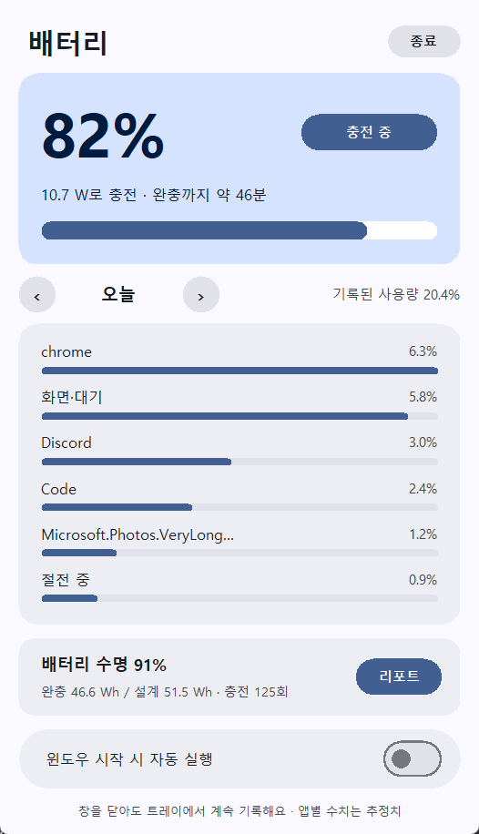
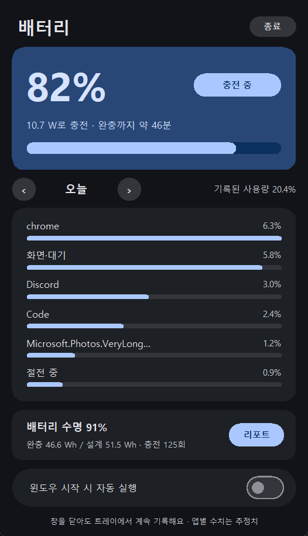

# 배터리 사용 기록기

오늘 어떤 앱이 노트북 배터리를 얼마나 썼는지 기록해서 보여주는 윈도우용 트레이 앱입니다.
파이썬 기본 라이브러리만 사용하고, 백그라운드에서는 30초에 한 번만 깨어납니다.

<p>
  
  
</p>

## 기능

- **실시간 배터리 상태**: 잔량, 소모·충전 전력(W), 남은 시간 또는 완충까지 걸리는 시간
- **앱별 사용량 기록**: 배터리로 쓰는 동안 줄어든 잔량을 앱별로 나눠 날짜별로 저장 (최근 60일, ‹ › 로 넘겨 보기)
- **배터리 수명**: 설계 용량 대비 현재 완충 용량, 충전 횟수
- **배터리 리포트**: 버튼 하나로 윈도우 기본 배터리 리포트(`powercfg /batteryreport`)를 만들어 브라우저로 열기
- **트레이 상주**: 창을 닫아도 계속 기록, 트레이 아이콘을 누르면 창이 열림
- **윈도우 시작 시 자동 실행**: 처음 실행할 때 물어보고, 창 아래 스위치로 켜고 끔
- 윈도우의 다크/라이트 설정을 따라가는 Material You 스타일 화면

## 실행

필요한 것: Windows 10/11 (64비트), Python 3.9 이상

```bat
py battery_log.py
```

| 옵션 | 설명 |
|---|---|
| `--hidden` | 창 없이 트레이에 숨은 채로 시작 (자동 실행에 쓰임) |
| `--test` | 자체 테스트 실행 |

## exe로 만들기

```bat
py -m pip install pyinstaller
build.bat
```

`dist\BatteryLog\` 폴더가 만들어집니다. `BatteryLog.exe`는 같은 폴더의 `_internal`과 함께 있어야 실행됩니다.
기록 파일 `battery_log.json`은 exe(또는 `battery_log.py`) 옆에 생깁니다.

## 앱별 사용량은 이렇게 추정합니다

윈도우는 앱별 소모 전력을 직접 알려주지 않아서, 다음 방식으로 나눕니다.

1. 30초마다 배터리 잔량과 모든 프로세스의 누적 CPU 사용 시간을 읽습니다.
2. 잔량이 줄면, 평소 가장 느리게 줄던 속도만큼은 **화면·대기**로 넣습니다.
3. 그보다 더 빨리 줄어든 몫은 그 사이 CPU를 쓴 앱들에게 사용 시간 비율대로 나눕니다.
4. 노트북을 덮어 둔 동안 줄어든 잔량은 **절전 중**으로 넣습니다.

한계:

- 화면 밝기를 올려서 늘어난 소모는 앱 쪽에 섞입니다.
- GPU나 네트워크를 많이 쓰는 앱은 실제보다 적게 잡힐 수 있습니다.
- 처음 실행한 뒤 몇 분은 대기 소모 속도를 배우는 중이라 화면·대기 쪽으로 쏠립니다.

## 라이선스

[MIT](LICENSE)
