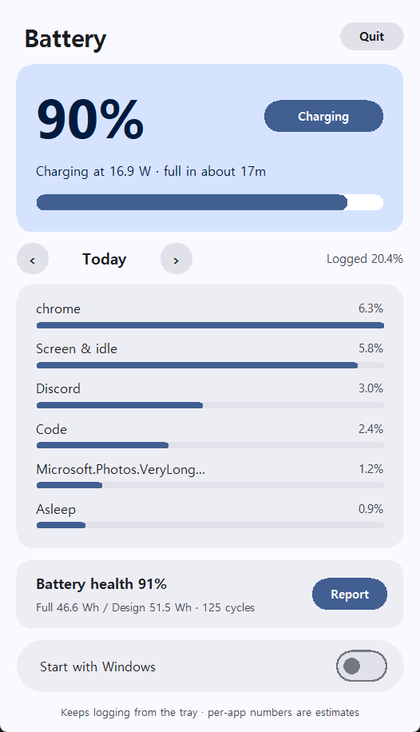
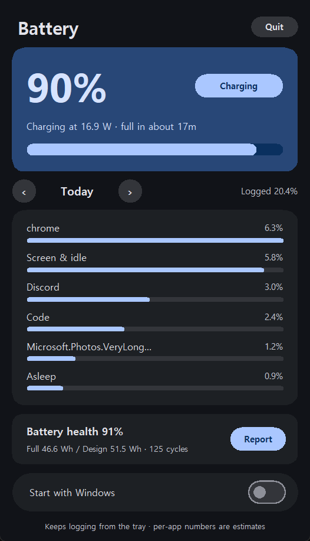

# Battery Log

**English** | [한국어](README.ko.md)

A small Windows tray app that logs which apps used your laptop battery today.
It uses only the Python standard library and wakes up just once every 30 seconds in the background.
The UI is shown in Korean when Windows is set to Korean, and in English otherwise.

<p>
  
  
</p>

## Features

- **Live battery status**: charge level, power draw or charging rate (W), time left or time to full
- **Per-app usage log**: battery drain split across apps while on battery, saved per day (last 60 days, browse with ‹ ›)
- **Battery health**: current full-charge capacity vs. design capacity, and cycle count
- **Battery report**: one button creates the built-in Windows battery report (`powercfg /batteryreport`) and opens it in your browser
- **Lives in the tray**: closing the window keeps logging; click the tray icon to open it again
- **Start with Windows**: asks on first launch, toggle anytime with the switch at the bottom
- Material You style UI that follows the Windows light/dark setting

## Run

Requirements: Windows 10/11 (64-bit), Python 3.9+

```bat
py battery_log.py
```

| Option | Description |
|---|---|
| `--hidden` | Start hidden in the tray (used for start with Windows) |
| `--test` | Run the self-test |

## Build an exe

```bat
py -m pip install pyinstaller
build.bat
```

This creates `dist\BatteryLog\`. Keep `BatteryLog.exe` together with the `_internal` folder next to it.
The log file `battery_log.json` is created next to the exe (or next to `battery_log.py`).

## How per-app usage is estimated

Windows doesn't report power use per app, so the drain is split like this:

1. Every 30 seconds, read the battery level and the total CPU time of every process.
2. When the level drops, the share matching your usual slowest drain rate goes to **Screen & idle**.
3. Anything draining faster than that is split across the apps that used the CPU in that window, by CPU time.
4. Drain while the laptop was closed or asleep goes to **Asleep**.

Limitations:

- Extra drain from turning up screen brightness ends up on the apps.
- Apps that lean on the GPU or network may be undercounted.
- For the first few minutes the idle drain rate is still being learned, so more goes to Screen & idle.
- Code comments are in Korean.

## License

[MIT](LICENSE)
